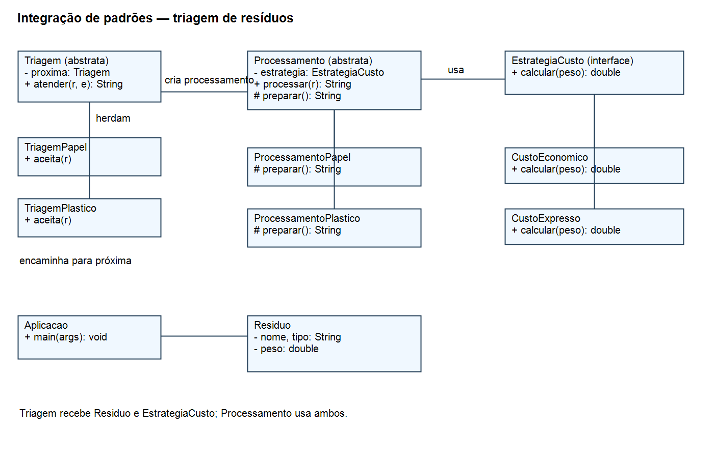

# Integração dos padrões Chain of Responsibility, Strategy e Template Method

Projeto desenvolvido para demonstrar a integração dos padrões de projeto **Chain of Responsibility**, **Strategy** e **Template Method** em Java, como aplicação prática da disciplina Arquitetura e Projeto de Software.

O projeto simula uma central de triagem de resíduos. A aplicação identifica o tipo do material, define como ele será preparado e calcula o custo de acordo com a modalidade escolhida. Os dados e valores são fictícios e simplificados para fins didáticos.

## 📌 Funcionamento

Cada resíduo possui nome, tipo e peso em quilogramas. A cadeia procura uma triagem capaz de processar o tipo informado:

| Tipo | Preparação |
| --- | --- |
| Papel | Separar e compactar papel |
| Plástico | Separar e triturar plástico |
| Outros tipos | Retornar uma mensagem de que não há processamento disponível |

Os tipos aceitos são `papel` e `plastico` (sem acento). A comparação ignora diferenças entre letras maiúsculas e minúsculas e espaços nas extremidades.

O custo é calculado conforme a estratégia selecionada:

| Estratégia | Valor fictício por quilograma |
| --- | --- |
| `CustoEconomico` | R$ 2,00 |
| `CustoExpresso` | R$ 4,00 |

O programa funciona em memória e apresenta o resultado no console. Ele não realiza coleta real, cria arquivos de processamento ou armazena dados em banco.

## 🔗 Padrão Chain of Responsibility

O **Chain of Responsibility** é um padrão comportamental que encaminha uma solicitação por uma cadeia de responsáveis até encontrar alguém capaz de atendê-la.

Neste projeto, a classe abstrata `Triagem` mantém uma referência para a próxima triagem. Cada implementação verifica se aceita o resíduo:

- `TriagemPapel`: atende resíduos do tipo `papel`.
- `TriagemPlastico`: atende resíduos do tipo `plastico`.

A cadeia utilizada na aplicação é criada assim:

```java
Triagem cadeia = new TriagemPapel(new TriagemPlastico(null));
```

Se a primeira triagem não aceitar o tipo, ela encaminha a solicitação para a próxima. Se nenhuma aceitar, o resultado é `Residuo sem processamento disponivel`.

## 🎯 Padrão Strategy

O **Strategy** é um padrão comportamental que define uma família de algoritmos e permite que eles sejam escolhidos e trocados conforme a necessidade.

A interface `EstrategiaCusto` define a operação de cálculo:

```java
interface EstrategiaCusto {
    double calcular(double peso);
}
```

As classes `CustoEconomico` e `CustoExpresso` implementam essa interface. A estratégia é recebida pelo processamento e pode ser alterada durante a execução:

```java
Processamento processamento = new ProcessamentoPapel(new CustoEconomico());
processamento.setEstrategia(new CustoExpresso());
```

## 🧩 Padrão Template Method

O **Template Method** é um padrão comportamental que define a estrutura de um algoritmo em uma classe base e permite que subclasses implementem etapas específicas.

A classe abstrata `Processamento` define o método `processar()`, que reúne a identificação do resíduo, a preparação e o cálculo do custo. O método é `final`, enquanto a preparação é definida pelas subclasses:

```java
final String processar(Residuo r) {
    Objects.requireNonNull(r);
    return "Residuo: " + r.nome + " | " + preparar() + " | Custo: R$ "
            + String.format(Locale.US, "%.2f", estrategia.calcular(r.peso));
}

abstract String preparar();
```

`ProcessamentoPapel` define a preparação do papel e `ProcessamentoPlastico` define a preparação do plástico. A estratégia escolhida realiza o cálculo do custo dentro do fluxo comum.

## 🔄 Integração entre os padrões

Uma solicitação pode ser feita desta forma:

```java
Triagem cadeia = new TriagemPapel(new TriagemPlastico(null));
Residuo residuo = new Residuo("Garrafas", "plastico", 3);

System.out.println(cadeia.atender(residuo, new CustoExpresso()));
```

O fluxo acontece da seguinte forma:

1. A primeira triagem recebe o resíduo e a estratégia de custo.
2. Como o tipo é plástico, a triagem de papel encaminha a solicitação para a próxima.
3. A triagem de plástico reconhece o tipo e cria um `ProcessamentoPlastico` com a estratégia recebida.
4. O método `processar()` executa o fluxo comum e chama a preparação definida pela subclasse.
5. A estratégia calcula o custo: 3 kg × R$ 4,00 = R$ 12,00.
6. O programa retorna o texto com o material, a preparação e o custo.

## 📁 Estrutura do projeto

```text
Integracao_Reciclagem/
├── src/
│   ├── main/java/
│   │   └── Aplicacao.java
│   └── test/java/
│       └── IntegracaoTest.java
├── diagrama-classes.png
├── pom.xml
└── README.md
```

Para facilitar a leitura do exemplo, as classes da aplicação estão reunidas em `Aplicacao.java`. Os testes estão em `IntegracaoTest.java`.

## 🚀 Como executar

### Pré-requisitos

- JDK 11 ou superior.
- Maven 3 instalado e disponível no terminal.

Abra o terminal na pasta que contém o `pom.xml` e compile o projeto:

```bash
mvn compile
```

Execute a demonstração:

```bash
java -cp target/classes Aplicacao
```

A saída esperada é:

```text
Residuo: Caixas | Separar e compactar papel | Custo: R$ 10.00
Residuo: Garrafas | Separar e triturar plastico | Custo: R$ 12.00
Residuo sem processamento disponivel
```

A aplicação usa `Locale.US` para apresentar os valores com ponto decimal.

## ✅ Testes automatizados

O projeto utiliza JUnit 5.10.2. A classe `IntegracaoTest` contém cinco métodos de teste:

| Teste | Verificação |
| --- | --- |
| `papelEconomico` | Processamento de papel com custo econômico |
| `plasticoExpressoPassaAoSegundoResponsavel` | Encaminhamento para a segunda triagem e custo expresso |
| `tipoNaoAtendido` | Mensagem para um tipo não tratado pela cadeia |
| `trocaEstrategia` | Alteração da estratégia no mesmo processamento |
| `rejeitaDadosInvalidos` | Rejeição de peso zero, peso `NaN` e nome vazio |

Para executar os testes:

```bash
mvn test
```

**Observação:** os testes estão incluídos no projeto, mas não foram executados no ambiente em que este arquivo foi preparado.

## 📊 Diagrama de classes

O diagrama de classes está disponível na raiz do projeto:



## 🛠️ Tecnologias utilizadas

- Java 11.
- Maven.
- JUnit 5.10.2.
- Maven Surefire Plugin 3.2.5.
- Padrões comportamentais Chain of Responsibility, Strategy e Template Method.

## 🎓 Objetivo acadêmico

Demonstrar como três padrões comportamentais colaboram na mesma solução: a cadeia encontra o responsável pelo resíduo, o Template Method organiza seu processamento e o Strategy define o cálculo do custo.

## 👤 Autor

**Felipe Baba**

Projeto desenvolvido para fins acadêmicos na disciplina Arquitetura e Projeto de Software.
